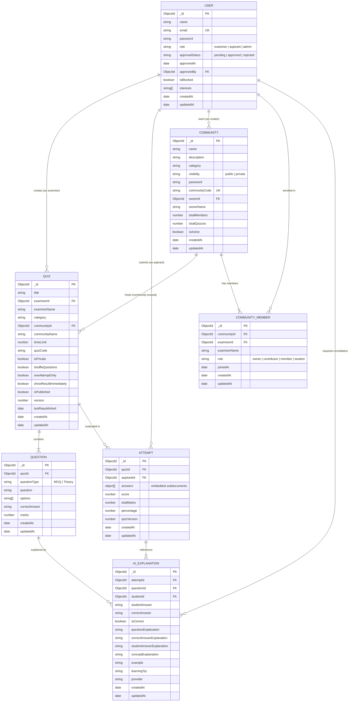

# DATABASE DESIGN AND DATA MODELS SPECIFICATION

## ONLINE QUIZ APPLICATION WITH ROLE-BASED ACCESS CONTROL, COMMUNITIES, AND AI EXPLANATIONS

**Document Version:** 1.0.0  
**Database Management System:** MongoDB (Document-Oriented NoSQL)  
**Object Data Modeling (ODM):** Mongoose 9.x  

---

## TABLE OF CONTENTS

1. [Database Overview & Design Philosophy](#1-database-overview--design-philosophy)
2. [Entity-Relationship (ER) Diagram](#2-entity-relationship-er-diagram)
3. [Model Schema Specifications](#3-model-schema-specifications)
   * 3.1 [User Model (`users` collection)](#31-user-model-users-collection)
   * 3.2 [Quiz Model (`quizzes` collection)](#32-quiz-model-quizzes-collection)
   * 3.3 [Question Model (`questions` collection)](#33-question-model-questions-collection)
   * 3.4 [Attempt Model (`attempts` collection)](#34-attempt-model-attempts-collection)
   * 3.5 [Community Model (`communities` collection)](#35-community-model-communities-collection)
   * 3.6 [CommunityMember Model (`communitymembers` collection)](#36-communitymember-model-communitymembers-collection)
   * 3.7 [AIExplanation Model (`aiexplanations` collection)](#37-aiexplanation-model-aiexplanations-collection)
4. [Relationship Cardinalities & Foreign Key References](#4-relationship-cardinalities--foreign-key-references)
5. [Database Indexing Strategy](#5-database-indexing-strategy)
6. [Data Integrity, Cascade Handling, and Versioning](#6-data-integrity-cascade-handling-and-versioning)
7. [Startup Migrations & Seeders](#7-startup-migrations--seeders)

---

## 1. DATABASE OVERVIEW & DESIGN PHILOSOPHY

The database architecture for the **Online Quiz Application** is implemented using **MongoDB** with **Mongoose ODM**. MongoDB's flexible, document-oriented data model is paired with Mongoose's schema validation, type casting, and relationship management via `ObjectId` references.

### Design Principles:
1. **Referential Integrity:** Core entities (`User`, `Quiz`, `Community`, `Attempt`) maintain normalized references (`ObjectId`) to avoid duplicate stale data.
2. **Subdocument Embedding for Performance:** The `Attempt` model embeds candidate answers as an array of subdocuments (`answers`), allowing atomic saving of entire exam submissions in a single database transaction.
3. **Fidelity Preservation via Versioning:** The `Quiz` model includes `version` and `lastRepublished` fields, and `Attempt` stores `quizVersion`, ensuring that edits to live quizzes do not corrupt the historical accuracy of completed submissions.
4. **Optimized Compound Indexing:** The `AIExplanation` model enforces uniqueness across `{ attemptId, questionId, studentId }` via a compound index, ensuring instant cache hits and zero redundant LLM queries.

---

## 2. ENTITY-RELATIONSHIP (ER) DIAGRAM

The following Mermaid diagram illustrates the exact collections, fields, and relationships implemented in the codebase:



---

## 3. MODEL SCHEMA SPECIFICATIONS

### 3.1 User Model (`users` collection)
**Source File:** `backend/models/User.js`  
**Description:** Stores authentication credentials, identity profiles, access roles, administrative vetting status, and student academic interests.

| Field Name | Data Type | Required | Default Value | Validations / Constraints | Description |
| :--- | :--- | :---: | :--- | :--- | :--- |
| `_id` | `ObjectId` | Auto | Auto UUID | Primary Key | MongoDB Unique Identifier |
| `name` | `String` | Yes | None | `required: true` | Full name of the user |
| `email` | `String` | Yes | None | `required: true`, `unique: true` | Login email address |
| `password` | `String` | Yes | None | `required: true` | Bcrypt hashed password string |
| `role` | `String` | Yes | None | `enum: ["examiner", "aspirant", "admin"]` | Access tier role |
| `approvalStatus` | `String` | No | `"approved"` | `enum: ["pending", "approved", "rejected"]` | Vetting status (default `"pending"` for self-registered examiners) |
| `approvedAt` | `Date` | No | `null` | None | Timestamp of admin approval |
| `approvedBy` | `ObjectId` | No | `null` | `ref: "User"` | Reference to admin user who approved account |
| `isBlocked` | `Boolean` | No | `false` | None | Flag for active account revocation |
| `interests` | `[String]` | No | `[]` | `trim: true` | Academic interest tags (for aspirants) |
| `createdAt` | `Date` | Auto | Timestamp | Managed by Mongoose | Account creation timestamp |
| `updatedAt` | `Date` | Auto | Timestamp | Managed by Mongoose | Account last update timestamp |

---

### 3.2 Quiz Model (`quizzes` collection)
**Source File:** `backend/models/Quiz.js`  
**Description:** Stores assessment metadata, author references, timing limits, private access codes, and republishing version numbers.

| Field Name | Data Type | Required | Default Value | Validations / Constraints | Description |
| :--- | :--- | :---: | :--- | :--- | :--- |
| `_id` | `ObjectId` | Auto | Auto UUID | Primary Key | MongoDB Unique Identifier |
| `title` | `String` | Yes | None | `required: true` | Title of the quiz |
| `examinerId` | `ObjectId` | No | None | `ref: "User"` | Reference to creator examiner |
| `examinerName` | `String` | Yes | None | `required: true` | Cached creator name |
| `category` | `String` | Yes | `"General Knowledge"` | `required: true` | Academic subject/category |
| `communityId` | `ObjectId` | No | `null` | `ref: "Community"` | Reference to host community (null for public platform quizzes) |
| `communityName` | `String` | No | `""` | None | Cached name of host community |
| `timeLimit` | `Number` | Yes | None | `required: true` | Time limit in minutes |
| `quizCode` | `String` | No | `""` | None | Access code for private quizzes |
| `isPrivate` | `Boolean` | No | `false` | None | Private quiz access toggle |
| `shuffleQuestions` | `Boolean` | No | `false` | None | Randomizes question sequence |
| `oneAttemptOnly` | `Boolean` | No | `false` | None | Restricts aspirant to single submission |
| `showResultImmediately` | `Boolean` | No | `false` | None | Displays score immediately upon submit |
| `isPublished` | `Boolean` | No | `false` | None | Publication status flag |
| `version` | `Number` | No | `1` | None | Version counter for tracking updates |
| `lastRepublished` | `Date` | No | None | None | Timestamp when quiz was last republished |
| `createdAt` | `Date` | Auto | Timestamp | Managed by Mongoose | Quiz creation timestamp |
| `updatedAt` | `Date` | Auto | Timestamp | Managed by Mongoose | Quiz last update timestamp |

---

### 3.3 Question Model (`questions` collection)
**Source File:** `backend/models/Question.js`  
**Description:** Stores individual assessment items linked to parent quizzes.

| Field Name | Data Type | Required | Default Value | Validations / Constraints | Description |
| :--- | :--- | :---: | :--- | :--- | :--- |
| `_id` | `ObjectId` | Auto | Auto UUID | Primary Key | MongoDB Unique Identifier |
| `quizId` | `ObjectId` | No | None | `ref: "Quiz"` | Reference to parent Quiz |
| `questionType` | `String` | No | None | `enum: ["MCQ", "Theory"]` | Item format classification |
| `question` | `String` | Yes | None | `required: true` | Question text / statement |
| `options` | `[String]` | No | `[]` | Array of strings | Multiple choice options |
| `correctAnswer` | `String` | No | None | None | Authoritative correct answer text |
| `marks` | `Number` | No | `1` | None | Point weight for correct response |
| `createdAt` | `Date` | Auto | Timestamp | Managed by Mongoose | Question creation timestamp |
| `updatedAt` | `Date` | Auto | Timestamp | Managed by Mongoose | Question last update timestamp |

---

### 3.4 Attempt Model (`attempts` collection)
**Source File:** `backend/models/Attempt.js`  
**Description:** Stores completed exam submissions by aspirants, embedding answer subdocuments and calculated scoring metrics.

| Field Name | Data Type | Required | Default Value | Validations / Constraints | Description |
| :--- | :--- | :---: | :--- | :--- | :--- |
| `_id` | `ObjectId` | Auto | Auto UUID | Primary Key | MongoDB Unique Identifier |
| `quizId` | `ObjectId` | Yes | None | `required: true`, `ref: "Quiz"` | Reference to attempted Quiz |
| `aspirantId` | `ObjectId` | Yes | None | `required: true`, `ref: "User"` | Reference to student User |
| `answers` | `[Subdocument]` | No | `[]` | Nested structure | Embedded answer array |
| `answers.$.questionId` | `ObjectId` | No | None | `ref: "Question"` | Reference to specific Question |
| `answers.$.selectedAnswer` | `String` | No | None | None | Option chosen by aspirant |
| `answers.$.isCorrect` | `Boolean` | No | None | None | Automated evaluation flag |
| `score` | `Number` | No | `0` | None | Total awarded points |
| `totalMarks` | `Number` | No | `0` | None | Total available points in quiz |
| `percentage` | `Number` | No | `0` | None | Percentage grade achieved (`score/totalMarks * 100`) |
| `quizVersion` | `Number` | No | `1` | None | Snapshot version of quiz during attempt |
| `createdAt` | `Date` | Auto | Timestamp | Managed by Mongoose | Exam submission timestamp |
| `updatedAt` | `Date` | Auto | Timestamp | Managed by Mongoose | Attempt last update timestamp |

---

### 3.5 Community Model (`communities` collection)
**Source File:** `backend/models/Community.js`  
**Description:** Manages collaborative educator/student subject hubs, visibility settings, and member statistics.

| Field Name | Data Type | Required | Default Value | Validations / Constraints | Description |
| :--- | :--- | :---: | :--- | :--- | :--- |
| `_id` | `ObjectId` | Auto | Auto UUID | Primary Key | MongoDB Unique Identifier |
| `name` | `String` | Yes | None | `required: true`, `trim: true` | Community display name |
| `description` | `String` | No | `""` | None | Overview of community purpose |
| `category` | `String` | No | `"Others"` | None | Subject classification |
| `visibility` | `String` | No | `"public"` | `enum: ["public", "private"]` | Public or password-gated |
| `password` | `String` | No | `null` | None | Access password for private communities |
| `communityCode` | `String` | Yes | None | `required: true`, `unique: true` | Unique 6-character identifier |
| `ownerId` | `ObjectId` | Yes | None | `required: true`, `ref: "User"` | Reference to creator examiner |
| `ownerName` | `String` | Yes | None | `required: true` | Creator display name |
| `totalMembers` | `Number` | No | `1` | None | Real-time enrolled member count |
| `totalQuizzes` | `Number` | No | `0` | None | Real-time community quiz count |
| `isActive` | `Boolean` | No | `true` | None | Active status flag |
| `createdAt` | `Date` | Auto | Timestamp | Managed by Mongoose | Community creation timestamp |
| `updatedAt` | `Date` | Auto | Timestamp | Managed by Mongoose | Community last update timestamp |

---

### 3.6 CommunityMember Model (`communitymembers` collection)
**Source File:** `backend/models/CommunityMember.js`  
**Description:** Junction model linking users (examiners and students) to communities with explicit roles.

| Field Name | Data Type | Required | Default Value | Validations / Constraints | Description |
| :--- | :--- | :---: | :--- | :--- | :--- |
| `_id` | `ObjectId` | Auto | Auto UUID | Primary Key | MongoDB Unique Identifier |
| `communityId` | `ObjectId` | Yes | None | `required: true`, `ref: "Community"` | Reference to Community |
| `examinerId` | `ObjectId` | Yes | None | `required: true`, `ref: "User"` | Reference to member User |
| `examinerName` | `String` | Yes | None | `required: true` | Member display name |
| `role` | `String` | No | `"contributor"` | `enum: ["owner", "contributor", "member", "student"]` | Community membership permission role |
| `joinedAt` | `Date` | No | `Date.now` | None | Timestamp when user joined |
| `createdAt` | `Date` | Auto | Timestamp | Managed by Mongoose | Association creation timestamp |
| `updatedAt` | `Date` | Auto | Timestamp | Managed by Mongoose | Association update timestamp |

---

### 3.7 AIExplanation Model (`aiexplanations` collection)
**Source File:** `backend/models/AIExplanation.js`  
**Description:** Persistently caches structured educational explanations generated by the Python AI microservice.

| Field Name | Data Type | Required | Default Value | Validations / Constraints | Description |
| :--- | :--- | :---: | :--- | :--- | :--- |
| `_id` | `ObjectId` | Auto | Auto UUID | Primary Key | MongoDB Unique Identifier |
| `attemptId` | `ObjectId` | Yes | None | `required: true`, `index: true`, `ref: "Attempt"` | Reference to specific Attempt |
| `questionId` | `ObjectId` | Yes | None | `required: true`, `index: true`, `ref: "Question"` | Reference to Question |
| `studentId` | `ObjectId` | Yes | None | `required: true`, `index: true`, `ref: "User"` | Reference to student User |
| `studentAnswer` | `String` | No | `""` | None | Option selected by student |
| `correctAnswer` | `String` | No | `""` | None | Correct option |
| `isCorrect` | `Boolean` | No | `false` | None | Whether student answered correctly |
| `questionExplanation` | `String` | No | `""` | None | Explanation of question objective |
| `correctAnswerExplanation`| `String` | No | `""` | None | Justification for correct option |
| `studentAnswerExplanation`| `String` | No | `""` | None | Diagnostic of student error |
| `conceptExplanation` | `String` | No | `""` | None | Theoretical background |
| `example` | `String` | No | `""` | None | Code sample or practical illustration |
| `learningTip` | `String` | No | `""` | None | Retention tip / mnemonic |
| `provider` | `String` | No | `"auto"` | None | Generator tag (`openai`, `groq`, `fallback`) |
| `createdAt` | `Date` | Auto | Timestamp | Managed by Mongoose | Cached creation timestamp |
| `updatedAt` | `Date` | Auto | Timestamp | Managed by Mongoose | Cache update timestamp |

---

## 4. RELATIONSHIP CARDINALITIES & FOREIGN KEY REFERENCES

| Source Model | Target Model | Relationship | Foreign Key Reference Field | Cardinality |
| :--- | :--- | :--- | :--- | :---: |
| `Quiz` | `User` | Examiner authorship | `examinerId` -> `User._id` | N : 1 |
| `Quiz` | `Community` | Community host | `communityId` -> `Community._id` | N : 1 |
| `Question` | `Quiz` | Quiz question items | `quizId` -> `Quiz._id` | N : 1 |
| `Attempt` | `Quiz` | Exam attempt target | `quizId` -> `Quiz._id` | N : 1 |
| `Attempt` | `User` | Aspirant examinee | `aspirantId` -> `User._id` | N : 1 |
| `Attempt.answers` | `Question` | Embedded answer reference | `answers.$.questionId` -> `Question._id` | N : 1 |
| `Community` | `User` | Community creator | `ownerId` -> `User._id` | N : 1 |
| `CommunityMember` | `Community` | Membership host | `communityId` -> `Community._id` | N : 1 |
| `CommunityMember` | `User` | Enrolled member | `examinerId` -> `User._id` | N : 1 |
| `AIExplanation` | `Attempt` | Attempt reference | `attemptId` -> `Attempt._id` | N : 1 |
| `AIExplanation` | `Question` | Question reference | `questionId` -> `Question._id` | N : 1 |
| `AIExplanation` | `User` | Student requester | `studentId` -> `User._id` | N : 1 |

---

## 5. DATABASE INDEXING STRATEGY

To maintain high throughput and sub-millisecond query performance, the following B-tree indexes are explicitly created in MongoDB:

```javascript
// 1. User Collection Indexes
db.users.createIndex({ email: 1 }, { unique: true });

// 2. Community Collection Indexes
db.communities.createIndex({ communityCode: 1 }, { unique: true });

// 3. Question Collection Indexes
db.questions.createIndex({ quizId: 1 });

// 4. Attempt Collection Indexes
db.attempts.createIndex({ quizId: 1 });
db.attempts.createIndex({ aspirantId: 1 });
db.attempts.createIndex({ quizId: 1, aspirantId: 1 });

// 5. CommunityMember Collection Indexes
db.communitymembers.createIndex({ communityId: 1, examinerId: 1 });

// 6. AIExplanation Compound Unique Index
db.aiexplanations.createIndex(
  { attemptId: 1, questionId: 1, studentId: 1 },
  { unique: true }
);
```

### Purpose of Key Indexes:
* `users.email (unique)`: Prevents duplicate registrations and provides $O(1)$ login lookups.
* `communities.communityCode (unique)`: Enables instantaneous community discovery by 6-character codes.
* `aiexplanations.{ attemptId, questionId, studentId } (unique)`: Enforces cache uniqueness and ensures instant retrieval of cached explanations.

---

## 6. DATA INTEGRITY, CASCADE HANDLING, AND VERSIONING

1. **Cascade Attempt Cleanup:**
   When an examiner purges a test submission (`DELETE /api/quiz/attempt/:attemptId`), the system removes the `Attempt` record and associated `AIExplanation` cache documents.
2. **Quiz Republishing Version Increment:**
   When an examiner updates a quiz's questions, `PUT /api/manage/republish/:quizId` executes:
   ```javascript
   await Quiz.findByIdAndUpdate(quizId, {
     $inc: { version: 1 },
     lastRepublished: new Date()
   });
   ```
   Past submissions remain tied to `Attempt.quizVersion`, preserving historical score integrity.

---

## 7. STARTUP MIGRATIONS & SEEDERS

On every backend startup (`server.js`), the following automated initialization routines execute:

1. **`seedAdminAndMigrate()` (`backend/config/adminSeeder.js`):**
   * Migrates legacy examiners without `approvalStatus` to `"approved"`.
   * Sets `isBlocked: false` where missing.
   * Checks if the Administrator defined in `ADMIN_EMAIL` exists; if not, hashes `ADMIN_PASSWORD` and creates the master Admin record.
2. **`migrateCommunityQuizzes()` (`backend/controllers/quizController.js`):**
   * Ensures that all existing quizzes without a `communityId` are initialized with `communityId: null` and `communityName: ""`.
