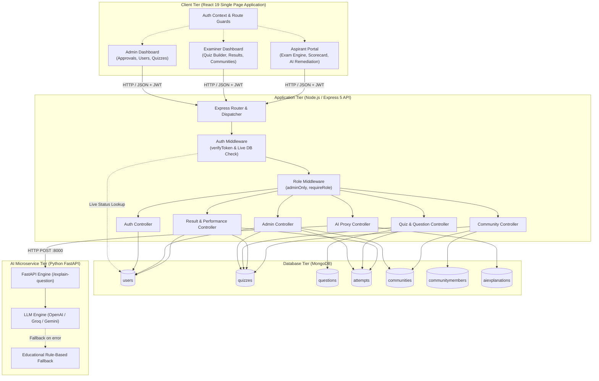
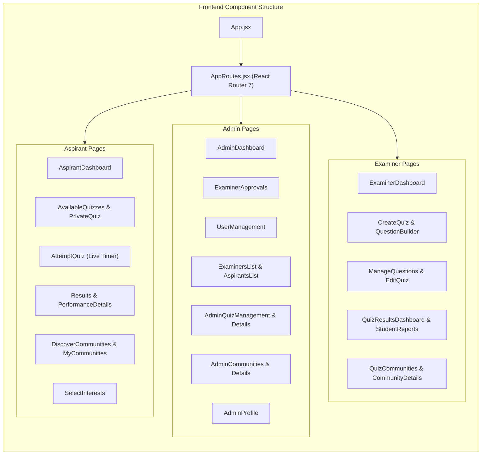
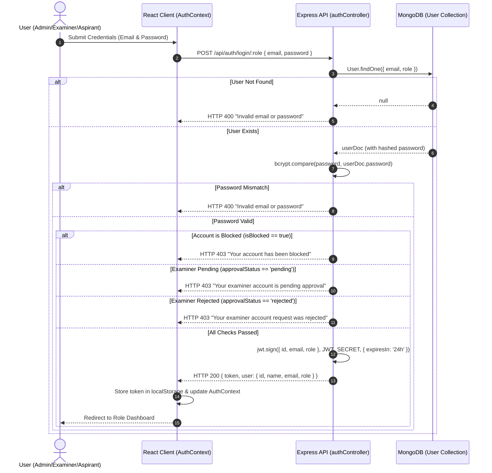
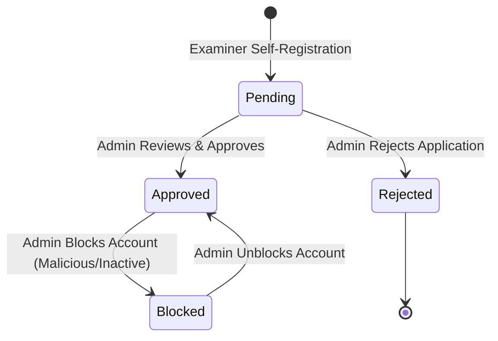
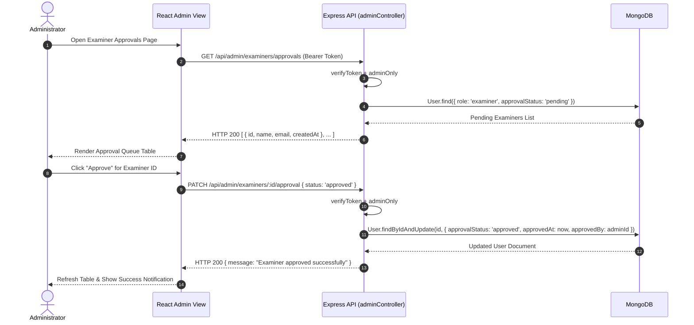
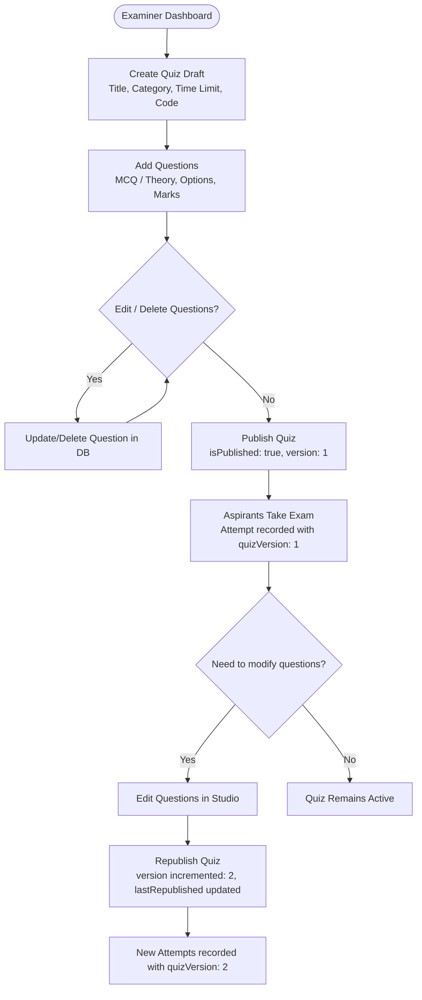
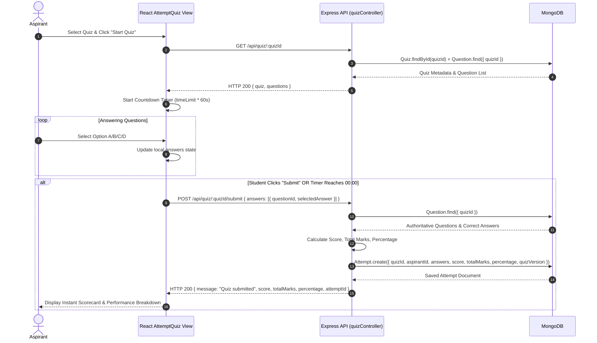
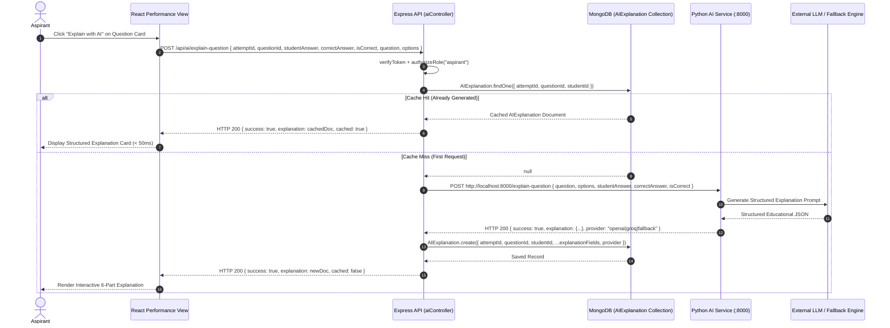

# SYSTEM ARCHITECTURE AND DESIGN

## ONLINE QUIZ APPLICATION WITH MULTI-ROLE RBAC, COMMUNITIES, AND AI EXPLANATIONS

**Document Version:** 1.0.0  
**Target Platform:** MERN Stack (MongoDB, Express.js 5, React 19, Node.js) + Python FastAPI AI Service  
**Architecture Style:** Decoupled Client-Server RESTful Architecture with Auxiliary Microservice  

---

## TABLE OF CONTENTS

1. [Architectural Overview](#1-architectural-overview)
2. [Multi-Tier System Layers](#2-multi-tier-system-layers)
   * 2.1 [Client Layer (Frontend SPA)](#21-client-layer-frontend-spa)
   * 2.2 [API Gateway & Application Layer (Node.js & Express)](#22-api-gateway--application-layer-nodejs--express)
   * 2.3 [Database Layer (MongoDB & Mongoose)](#23-database-layer-mongodb--mongoose)
   * 2.4 [AI Microservice Layer (Python FastAPI)](#24-ai-microservice-layer-python-fastapi)
3. [System Architecture Diagram](#3-system-architecture-diagram)
4. [Application Component Diagram](#4-application-component-diagram)
5. [Authentication & Authorization Flow](#5-authentication--authorization-flow)
   * 5.1 [Dynamic Live Database Verification](#51-dynamic-live-database-verification)
   * 5.2 [Authentication Flow Diagram](#52-authentication-flow-diagram)
6. [Admin Governance & Approval Flow](#6-admin-governance--approval-flow)
   * 6.1 [Examiner Vetting Lifecycle](#61-examiner-vetting-lifecycle)
   * 6.2 [Admin Approval Sequence Diagram](#62-admin-approval-sequence-diagram)
7. [Quiz Authoring, Publishing & Versioning Flow](#7-quiz-authoring-publishing--versioning-flow)
   * 7.1 [Fidelity Preservation via Versioning](#71-fidelity-preservation-via-versioning)
   * 7.2 [Quiz Lifecycle Flowchart](#72-quiz-lifecycle-flowchart)
8. [Quiz Attempt, Evaluation & Scoring Flow](#8-quiz-attempt-evaluation--scoring-flow)
   * 8.1 [Synchronized Timer & Automated Grading](#81-synchronized-timer--automated-grading)
   * 8.2 [Attempt & Evaluation Sequence Diagram](#82-attempt--evaluation-sequence-diagram)
9. [Collaborative Community Data Flow](#9-collaborative-community-data-flow)
   * 9.1 [Community Access & Isolation Model](#91-community-access--isolation-model)
   * 9.2 [Community Data Flow Diagram](#92-community-data-flow-diagram)
10. [AI-Powered Explanation Microservice Flow](#10-ai-powered-explanation-microservice-flow)
    * 10.1 [Proxy & Cache Architecture](#101-proxy--cache-architecture)
    * 10.2 [AI Remediation Sequence Diagram](#102-ai-remediation-sequence-diagram)
11. [Cross-Cutting Concerns & Security Architecture](#11-cross-cutting-concerns--security-architecture)

---

## 1. ARCHITECTURAL OVERVIEW

The **Online Quiz Application** is engineered as a modern, decoupled web platform leveraging the **MERN stack** (MongoDB, Express.js, React 19, Node.js) along with an auxiliary **Python FastAPI** AI microservice.

The architecture emphasizes:
* **Stateless REST Communication:** Frontend and backend communicate exclusively over HTTP/HTTPS exchanging JSON payloads, maintaining statelessness via JSON Web Tokens.
* **Granular Role-Based Access Control (RBAC):** Strict separation between `Admin`, `Examiner`, and `Aspirant` domains.
* **Real-Time Database Verification:** Every protected API call performs an active database lookup (`verifyToken`) to ensure revoked, blocked, or unapproved accounts cannot perform actions, mitigating the classic vulnerability of stale JWTs.
* **Idempotent Caching:** Educational AI explanations are generated on-demand and cached in MongoDB using unique compound indexes to minimize latency and third-party LLM costs.

---

## 2. MULTI-TIER SYSTEM LAYERS

```
+=============================================================================+
|                                CLIENT LAYER                                 |
|   React 19 Single Page Application (SPA) powered by Vite 8 & React Router 7 |
|   - Contexts: AuthContext (Role, Token, User State)                         |
|   - UI Components: Glassmorphic Cards, Timers, Quiz Builders, Modals       |
|   - Layouts: AdminLayout, ExaminerLayout, AspirantLayout                    |
+=============================================================================+
                                      |
                      JSON REST API / Bearer Token
                                      v
+=============================================================================+
|                              APPLICATION LAYER                              |
|                    Express.js 5.x REST API (Node.js 18+)                    |
|   - Middlewares: verifyToken (Live DB check), requireRole, CORS, Morgan     |
|   - Controllers: Auth, Admin, Quiz, Question, Result, Community, AI        |
|   - Seeders & Migrations: adminSeeder, migrateCommunityQuizzes              |
+=============================================================================+
           |                                                 |
    Mongoose ODM (BSON)                             Internal HTTP REST
           v                                                 v
+=============================+               +===============================+
|       DATABASE LAYER        |               |     AI MICROSERVICE LAYER     |
|   MongoDB Database Engine   |               |   Python FastAPI (Port 8000)  |
| - Users, Quizzes, Questions |               | - LLM Engine (OpenAI/Groq)    |
| - Attempts, Communities     |               | - Rule-Based Fallback Engine  |
| - CommunityMembers, AIExps  |               | - Pydantic Request Models     |
+=============================+               +===============================+
```

### 2.1 Client Layer (Frontend SPA)
* **Framework & Build:** React 19 bootstrapped with Vite 8 for fast Hot Module Replacement (HMR).
* **Navigation:** React Router 7 handling client-side routing, code splitting, and `ProtectedRoute` guards.
* **State Management:** React Context API (`AuthContext`) managing user session state, bearer tokens, and global authentication credentials without unnecessary third-party state libraries.
* **Design Language:** Custom Vanilla CSS design system incorporating modern glassmorphism, responsive grid/flexbox layouts, CSS variables for theming, and micro-animations.

### 2.2 API Gateway & Application Layer (Node.js & Express)
* **Server Framework:** Express.js 5.x running on Node.js runtime.
* **Middleware Pipeline:**
  1. `cors`: Configured with strict origin whitelisting (`http://localhost:5173`, `http://localhost:5174`, `http://localhost:3000`) and credentials support.
  2. `express.json`: Parsing incoming JSON request bodies.
  3. `morgan`: Structured HTTP request logging for development and monitoring.
  4. `verifyToken`: Custom authentication middleware verifying JWT signatures and performing live DB queries against the `User` model.
  5. `requireRole` / `adminOnly`: Role authorization guards.
* **Modular Routing:** Separate route files mapped to resource-specific endpoints (`/api/auth`, `/api/admin`, `/api/quiz`, `/api/manage`, `/api/results`, `/api/performance`, `/api/community`, `/api/student`, `/api/profile`, `/api/ai`).

### 2.3 Database Layer (MongoDB & Mongoose)
* **Database Engine:** MongoDB document store.
* **Object Data Modeling (ODM):** Mongoose 9.x enforcing strict schema definitions, type casting, default values, validators, and relationship population via `ObjectId` references.
* **Indexing:** Single-field indexes (`email`, `quizCode`, `communityCode`) and compound unique indexes (`{ attemptId: 1, questionId: 1, studentId: 1 }`).

### 2.4 AI Microservice Layer (Python FastAPI)
* **Framework:** Python 3.10+ with FastAPI and Uvicorn ASGI server.
* **Data Validation:** Pydantic models validating input payloads (`ExplainQuestionRequest`) and structuring responses (`ExplainQuestionResponse`).
* **Multi-Provider Fallback:** Integrates with OpenAI, Groq, or Google Gemini when API keys are configured, and gracefully degrades to a deterministic educational explanation generator when offline or unconfigured.

---

## 3. SYSTEM ARCHITECTURE DIAGRAM



---

## 4. APPLICATION COMPONENT DIAGRAM



---

## 5. AUTHENTICATION & AUTHORIZATION FLOW

### 5.1 Dynamic Live Database Verification
Standard JWT implementations suffer from token revocation lag: if a user is blocked or an examiner's approval is revoked, their signed token remains valid until it expires. 

The **Online Quiz Application** addresses this through a dynamic verification architecture:
1. The client attaches `Authorization: Bearer <token>` to each request.
2. `verifyToken` middleware decrypts and validates the cryptographic signature using `JWT_SECRET`.
3. `verifyToken` immediately executes `User.findById(verified.id)`.
4. If `user.isBlocked === true`, the request is denied with `HTTP 403 Forbidden ("Your account has been blocked by the administrator.")`.
5. If `user.role === "examiner"` and `user.approvalStatus !== "approved"`, the request is denied with `HTTP 403 Forbidden`.
6. Only when all real-time criteria pass is the sanitized user document attached to `req.user` and passed to `next()`.

### 5.2 Authentication Flow Diagram



---

## 6. ADMIN GOVERNANCE & APPROVAL FLOW

### 6.1 Examiner Vetting Lifecycle
To ensure assessment quality and institutional security, self-registered examiners are quarantined in a `pending` status. Only approved examiners can log in, author quizzes, or manage communities.



### 6.2 Admin Approval Sequence Diagram



---

## 7. QUIZ AUTHORING, PUBLISHING & VERSIONING FLOW

### 7.1 Fidelity Preservation via Versioning
When an examiner modifies questions on an already-published quiz, naive systems overwrite the questions, invalidating scores and answers on past student submissions. 

The **Online Quiz Application** incorporates a versioning pipeline:
* Each quiz maintains a `version` counter (default `1`).
* Each completed attempt records `quizVersion: quiz.version`.
* When an examiner modifies questions and triggers `PUT /api/manage/republish/:quizId`, the backend increments `version += 1` and updates `lastRepublished = new Date()`.
* Historical attempts remain intact, referencing the exact question snapshot corresponding to their attempt version.

### 7.2 Quiz Lifecycle Flowchart



---

## 8. QUIZ ATTEMPT, EVALUATION & SCORING FLOW

### 8.1 Synchronized Timer & Automated Grading
1. When an aspirant starts a quiz, the frontend loads the question array and initializes an active countdown timer calculated from `quiz.timeLimit * 60` seconds.
2. If `shuffleQuestions === true`, the frontend randomizes the presentation order.
3. If the countdown reaches `00:00`, the exam interface automatically triggers the submit handler.
4. On submission (`POST /api/quiz/:quizId/submit`), the backend:
   * Retrieves the authoritative questions from the `Question` collection.
   * Compares the student's `selectedAnswer` against `question.correctAnswer`.
   * Computes awarded marks, total available marks, and percentage.
   * Inserts an `Attempt` document containing sub-document answer evaluations.
   * Returns the final score immediately if `quiz.showResultImmediately === true`.

### 8.2 Attempt & Evaluation Sequence Diagram



---

## 9. COLLABORATIVE COMMUNITY DATA FLOW

### 9.1 Community Access & Isolation Model
* **Public Communities (`visibility: "public"`):** Discoverable in the public directory; any registered user can join instantly.
* **Private Communities (`visibility: "private"`):** Protected by a community `password`; requires credential entry to join.
* **Community Quizzes (`quiz.communityId !== null`):** Quizzes published within a community are isolated to verified members of that community.

### 9.2 Community Data Flow Diagram

```mermaid
graph TD
    subgraph CommunityCreation ["Creation & Membership"]
        Examiner["Examiner (Creator)"] -->|POST /api/community/create| CommCtrl["Community Controller"]
        CommCtrl -->|Create Community doc| ColComm[("communities")]
        CommCtrl -->|Create Member (role: owner)| ColMem[("communitymembers")]
    end

    subgraph CommunityJoining ["Discovery & Joining"]
        User["Aspirant / Peer Examiner"] -->|GET /api/community/discover| CommCtrl
        CommCtrl -->|Return Public & Private summaries| User
        User -->|POST /api/community/join { code, password }| CommCtrl
        CommCtrl -->|Validate Password if Private| CommCtrl
        CommCtrl -->|Insert Member Record| ColMem
        CommCtrl -->|Increment totalMembers| ColComm
    end

    subgraph CommunityQuizzes ["Scoped Quiz Authoring & Access"]
        Examiner -->|POST /api/quiz/create { communityId }| QuizCtrl["Quiz Controller"]
        QuizCtrl -->|Save Quiz with communityId| ColQuiz[("quizzes")]
        User -->|GET /api/student/community-quizzes| StudCtrl["Student Controller"]
        StudCtrl -->|Query enrolled communities| ColMem
        StudCtrl -->|Fetch Quizzes where communityId in enrolled| ColQuiz
        StudCtrl -->|Return Exclusive Quizzes| User
    end
```

---

## 10. AI-POWERED EXPLANATION MICROSERVICE FLOW

### 10.1 Proxy & Cache Architecture
To prevent slow response times and eliminate redundant API expenses with external LLM providers, the system implements a strict caching pipeline:
1. The Aspirant clicks "AI Explanation" for a specific question on an attempt review page.
2. The Node.js Express backend checks the `AIExplanation` collection using the compound query `{ attemptId, questionId, studentId }`.
3. **Cache Hit:** If found, the cached JSON explanation is returned immediately (< 50ms).
4. **Cache Miss:** If not found, Express forwards the request to the Python FastAPI microservice (`http://localhost:8000/explain-question`).
5. FastAPI queries the LLM provider (or invokes the educational heuristic engine), validates the output against the Pydantic schema, and returns it.
6. Express persists the explanation into MongoDB and sends it to the client.

### 10.2 AI Remediation Sequence Diagram



---

## 11. CROSS-CUTTING CONCERNS & SECURITY ARCHITECTURE

### 11.1 Security Measures
* **Bcrypt Password Salting:** Minimum 10 salt rounds prevent rainbow table attacks.
* **Stateless Token Verification with Live Database Revocation:** Combines stateless scalability with instantaneous revocation upon user blocking.
* **No Prefilled Credentials:** Frontend login components mount with blank states, disabling browser autofill vulnerabilities and eliminating hardcoded credentials in the DOM.
* **CORS Origin Filtering:** Server strictly accepts requests originating from recognized client ports (`5173`, `5174`, `3000`).

### 11.2 Error Handling & Resilience
* Express async handlers use `try/catch` blocks returning standard JSON errors.
* FastAPI service isolates external LLM timeouts, falling back to rule-based explanations to guarantee 100% uptime for students.
* Mongoose connection lifecycle initializes Admin seeding and community migrations on startup with robust logging.
